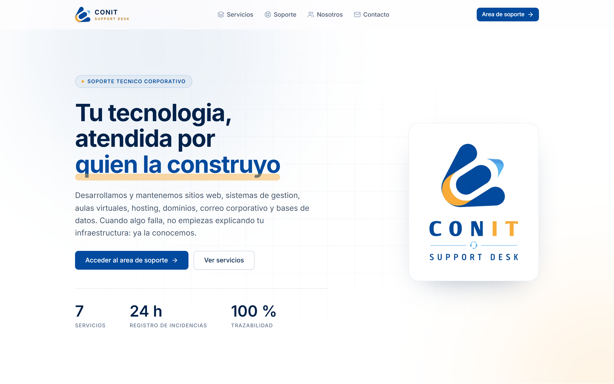
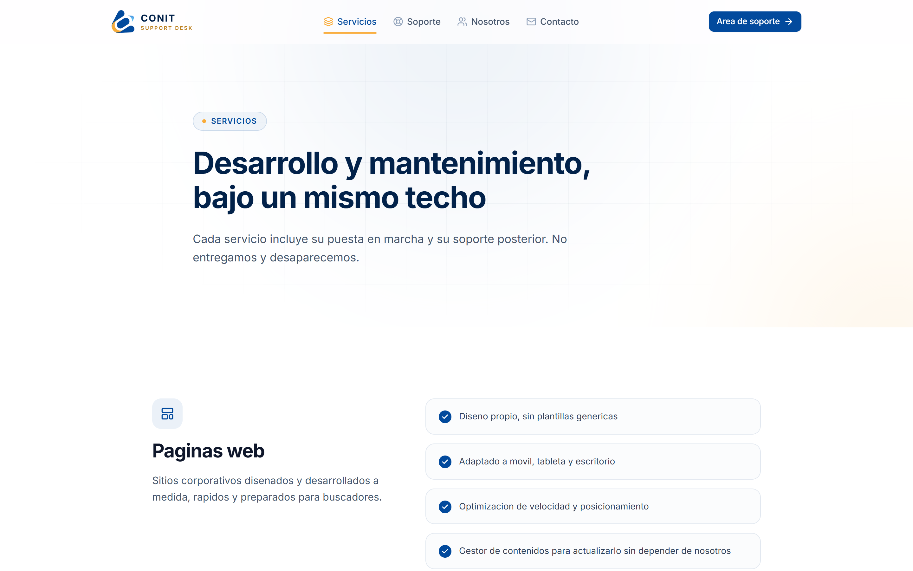
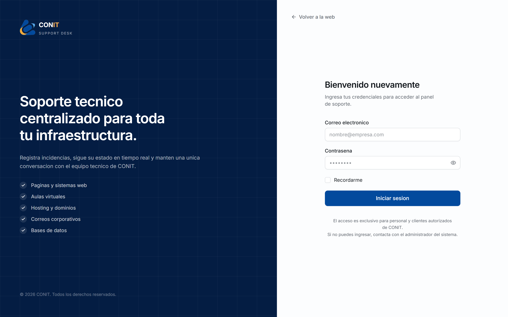
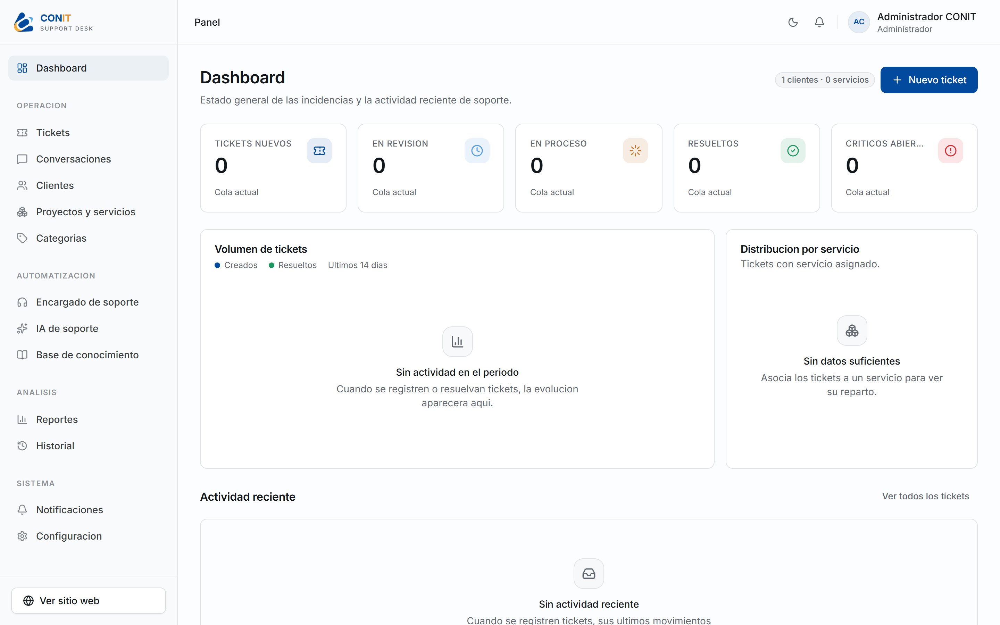
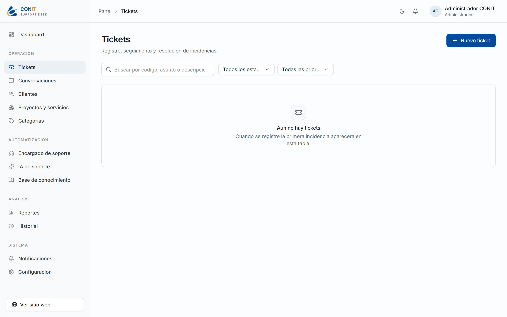
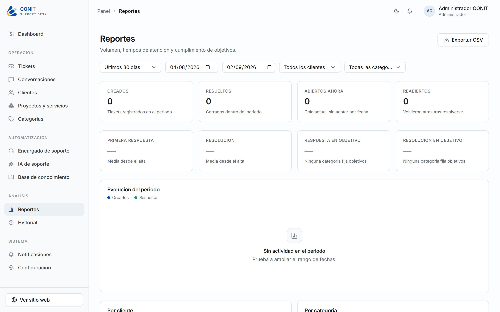
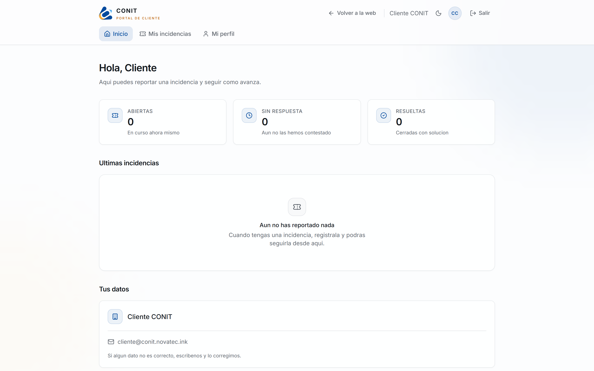
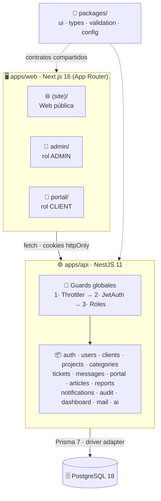
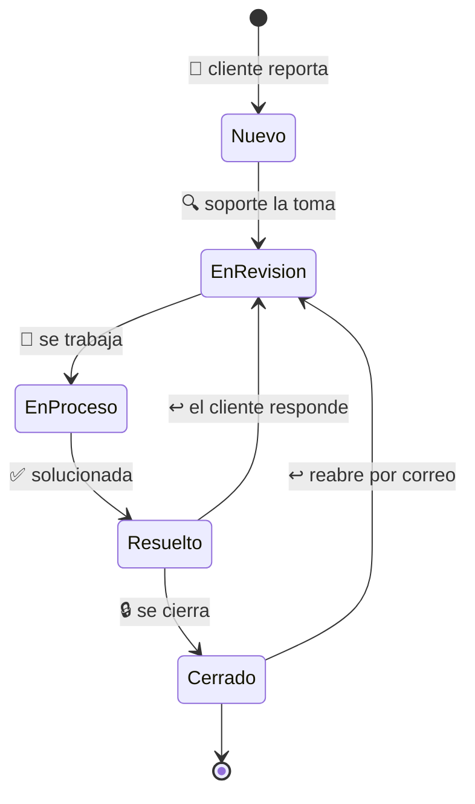
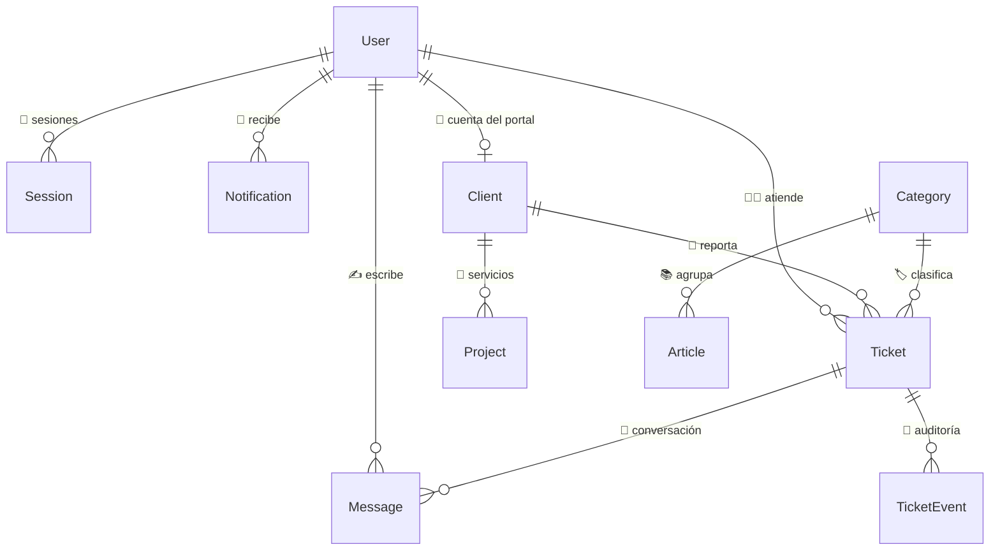

<div align="center">


# 🎫 CONIT Support Desk

### 🛠️ Mesa de ayuda corporativa para el soporte técnico de CONIT

**🌐 Web pública · 🧭 Panel interno · 👤 Portal de cliente**<br />
Tres caras, una sola base de datos.

<br />

[](https://nextjs.org/)
[](https://react.dev/)
[](https://nestjs.com/)
[](https://www.prisma.io/)

[](https://www.postgresql.org/)
[](https://www.typescriptlang.org/)
[](https://tailwindcss.com/)
[](https://turbo.build/repo)

[](https://conit.novatec.ink)
[](https://api.conit.novatec.ink/health)
[](#-licencia)

<sub>

[🎯 Qué resuelve](#-qué-resuelve) ·
[🖼️ Capturas](#️-capturas) ·
[✨ Capacidades](#-capacidades) ·
[🏗️ Arquitectura](#️-arquitectura) ·
[⚡ Puesta en marcha](#-puesta-en-marcha) ·
[🔌 API](#-api) ·
[🗄️ Datos](#️-modelo-de-datos) ·
[🚀 Despliegue](#-despliegue) ·
[📜 Licencia](#-licencia)

</sub>

</div>

---

## 🎯 Qué resuelve

CONIT desarrolla y mantiene la infraestructura digital de sus clientes: 🌐 sitios
y sistemas web, 🎓 aulas virtuales, 🖥️ hosting, 🔗 dominios, 📧 correo corporativo
y 🗄️ bases de datos. Cuando algo falla, la incidencia llegaba por correo, teléfono
o WhatsApp — y se perdía el rastro.

Este sistema centraliza ese flujo. Cada incidencia recibe un **código
correlativo** (`CNT-0042`), un responsable y un historial consultable. El cliente
ve el avance sin tener que preguntar; el equipo trabaja sobre una única cola con
prioridades y objetivos de tiempo medibles. ✅

---

## 🖼️ Capturas

### 🎬 Presentación de entrada

La web abre con el vídeo de marca y una barra de progreso medida sobre **bytes
reales descargados**, no una animación decorativa. Se ve una vez por sesión, se
salta con `Esc` y no aparece para quien pide movimiento reducido. ♿

<div align="center">
  <a href="apps/web/public/conit.mp4">
    
    <br />
    <sub><b>▶️ Ver el vídeo</b> · <code>apps/web/public/conit.mp4</code> · 4,7 MB</sub>
  </a>
</div>

### 🌐 Web pública

<div align="center">
  
  <br /><sub>Portada — base blanca con azul <code>#024A9D</code> y ámbar <code>#F9AB38</code> de marca</sub>
</div>

<br />

<div align="center">
  
  <br /><sub>Servicios — los siete que presta CONIT</sub>
</div>

### 🔐 Acceso

<div align="center">
  
  <br /><sub>Una sola entrada: el sistema lleva al panel o al portal según el rol</sub>
</div>

### 🧭 Panel interno

<div align="center">
  
  <br /><sub>Dashboard — cola actual, volumen y actividad reciente</sub>
</div>

<br />

<table>
<tr>
<td width="50%">
  
  <br /><sub align="center">🎫 Tickets con filtros y paginación</sub>
</td>
<td width="50%">
  
  <br /><sub align="center">📊 Reportes y cumplimiento de objetivos</sub>
</td>
</tr>
</table>

### 👤 Portal de cliente

<div align="center">
  
  <br /><sub>El cliente ve solo lo suyo — las notas internas nunca salen de aquí</sub>
</div>

> [!NOTE]
> Las capturas son de **producción real**, con la base recién sembrada. Por eso
> los contadores están a cero: no hay datos de demostración en el despliegue.

---

## ✨ Capacidades

<table>
<tr>
<td width="50%" valign="top">

### 🎫 Ciclo de vida de la incidencia

- 🔢 Numeración atómica por secuencia de PostgreSQL — no existen dos códigos iguales
- 🔄 Estados `Nuevo → En revisión → En proceso → Resuelto → Cerrado`, con transiciones validadas en el servidor
- 🚦 Prioridades `Baja` · `Media` · `Alta` · `Crítica`
- 📜 Auditoría inmutable: quién cambió qué y cuándo

</td>
<td width="50%" valign="top">

### 💬 Conversación y correo

- 🧵 Hilo por ticket con mensajes públicos y notas internas
- ⏱️ La primera respuesta la marca **solo** un mensaje público — es lo único que el cliente ve
- 📥 El correo del cliente entra al sistema y se convierte en ticket, o se añade al hilo si cita su código
- 📤 Acuse de recibo, respuesta y aviso de resolución, en la identidad de CONIT

</td>
</tr>
<tr>
<td valign="top">

### 📊 Análisis honesto

- 📈 Volumen por periodo, tiempos medios y cumplimiento del objetivo de cada categoría
- 🔍 Desglose por cliente, categoría, estado, prioridad y responsable
- 📄 Exportación CSV generada en el servidor sobre el periodo completo
- ➖ Si una métrica no se puede medir se devuelve `null` y se muestra una raya — **nunca un cero inventado**

</td>
<td valign="top">

### 🔒 Seguridad

- 🍪 Tokens en cookies `httpOnly`, invisibles para JavaScript
- 🔁 Sesiones persistidas con rotación de refresh y detección de reutilización
- 🛡️ Argon2id según parámetros OWASP
- 🚫 Denegación por defecto: el acceso es la excepción, no la norma
- 🧱 Rate limiting, Helmet, CORS y validación estricta de DTO

</td>
</tr>
</table>

### 🤖 Asistente de IA *(opcional)*

Redacta borradores de respuesta ✍️, sugiere clasificación 🏷️ y resume casos
largos 📝. La categoría sale del **catálogo real** y nada se aplica sin que una
persona lo confirme. Sin clave configurada, el asistente se declara no disponible
y el resto del sistema funciona igual.

---

## 🏗️ Arquitectura



### 🔄 Ciclo de una incidencia



### 💡 Decisiones que conviene conocer

| | Decisión | Por qué |
| :-: | :--- | :--- |
| 🍪 | **Tokens en cookies `httpOnly`** | Un XSS no puede leer la sesión. `localStorage` sí sería legible. |
| 🗃️ | **Sesión persistida en base** | Permite cerrar sesión de verdad y revocar por dispositivo. Un JWT suelto vale hasta que caduca. |
| 🚫 | **Denegar por defecto** | Un endpoint nuevo nace protegido. Lo contrario deja huecos al olvidar un decorador. |
| 🧾 | **Contratos del portal aparte** | Si el cliente reutilizara los del panel, cualquier campo nuevo quedaría expuesto sin que nadie lo notara. |
| 🔎 | **Filtrar en la consulta, no después** | Las notas internas nunca salen de la base. Filtrarlas al serializar depende de acordarse. |
| ⚛️ | **Markdown a nodos de React** | Sin `dangerouslySetInnerHTML`: la inyección de HTML es imposible por construcción, no por saneado. |
| 🖼️ | **Imágenes validadas por firma de bytes** | El `mimetype` lo escribe quien sube el fichero; los primeros bytes no se pueden falsear. |
| ➖ | **`null` en vez de `0`** | Un cero se lee como dato medido. Una métrica sin base se declara como tal. |
| 📦 | **Envoltura de respuesta única** | `{ success, message, data }` en un solo interceptor: el cliente trata todas las respuestas igual. |

---

## ⚡ Puesta en marcha

### 📋 Requisitos

| | | Versión |
| :-: | :--- | :--- |
| 🟢 | Node.js | `>= 22` |
| 📦 | pnpm | `>= 10` |
| 🐘 | PostgreSQL | `17` o `18` *(o Docker)* |

### 📥 Instalación

```bash
git clone https://github.com/Luiscarranza13/conit-support.git
cd conit-support
pnpm install
pnpm setup:env          # 🔑 genera .env con secretos aleatorios
```

### 🗄️ Base de datos

<details>
<summary><b>🐳 Opción A — Docker</b> <i>(recomendado)</i></summary>

<br />

```bash
docker compose up -d postgres
```

</details>

<details>
<summary><b>🐘 Opción B — PostgreSQL local</b></summary>

<br />

```bash
pnpm db:setup           # imprime el SQL de aprovisionamiento, no lo ejecuta
```

El script **muestra** las sentencias para que las revises antes de aplicarlas:
la contraseña del superusuario nunca pasa por el proyecto. 🔐

</details>

```bash
pnpm db:migrate
pnpm db:seed
```

> [!NOTE]
> **🌱 Datos de demostración.** Para poblar la base con clientes, servicios,
> tickets y artículos de ejemplo, pon `SEED_DEMO_DATA=true` en `apps/api/.env`
> antes de sembrar. Está desactivado por defecto para que nunca lleguen a un
> despliegue real.
>
> El seed es idempotente y **omite lo que ya existe**. Si cambias los datos de
> demostración y quieres regenerarlos, retira antes los tickets sembrados con
> `node scripts/reset-demo-tickets.cjs` desde `apps/api/`.

### ▶️ Arrancar

```bash
pnpm dev
```

| | | |
| :-: | :--- | :--- |
| 🖥️ | Web y panel | http://localhost:3000 |
| ⚙️ | API | http://localhost:4000/api/v1 |
| 📚 | Swagger | http://localhost:4000/api/docs |
| 💚 | Salud | http://localhost:4000/health |

---

## 🔌 API

Respuesta uniforme, aplicada por un único interceptor:

```jsonc
// ✅ Correcta
{ "success": true, "message": "Tickets obtenidos correctamente", "data": { } }

// ❌ Error — nunca expone trazas ni detalles internos
{ "success": false, "message": "La incidencia no existe", "error": "NOT_FOUND" }
```

<details>
<summary><b>📖 Endpoints principales</b></summary>

<br />

| Método | Ruta | Acceso |
| :--- | :--- | :--- |
| `GET` | `/health` | 🌍 Público |
| `POST` | `/api/v1/auth/login` | 🌍 Público *(5 req/min)* |
| `POST` | `/api/v1/auth/refresh` · `/logout` | 🔓 Sesión activa |
| `POST` | `/api/v1/auth/change-password` | 🔓 Sesión activa |
| `GET` `PATCH` | `/api/v1/users/me` | 👤 Autenticado |
| `POST` `DELETE` | `/api/v1/users/me/avatar` | 👤 Autenticado |
| `GET` | `/api/v1/users/team` | 🧭 Admin |
| `GET` `POST` | `/api/v1/clients` · `/projects` · `/categories` | 🧭 Admin |
| `GET` `POST` `DELETE` | `/api/v1/clients/:id/portal-access` | 🧭 Admin |
| `GET` `POST` | `/api/v1/tickets` | 🧭 Admin |
| `GET` `PATCH` `DELETE` | `/api/v1/tickets/:idOrCode` | 🧭 Admin |
| `GET` `POST` | `/api/v1/tickets/:idOrCode/messages` | 🧭 Admin |
| `GET` | `/api/v1/dashboard/summary` | 🧭 Admin |
| `GET` | `/api/v1/reports` · `/reports/export` | 🧭 Admin |
| `GET` | `/api/v1/audit` · `/audit/summary` | 🧭 Admin |
| `GET` `POST` | `/api/v1/articles` | 🧭 Admin |
| `GET` `PATCH` | `/api/v1/notifications` · `/preferences` | 👤 Autenticado |
| `GET` | `/api/v1/portal/profile` · `/portal/tickets` | 🙋 Cliente |
| `POST` | `/api/v1/portal/tickets` | 🙋 Cliente |
| `POST` | `/api/v1/ai/tickets/:idOrCode/reply` · `/classify` · `/summary` | 🧭 Admin |

📚 La referencia completa, con esquemas y ejemplos, vive en **`/api/docs`**.

</details>

---

## 🗄️ Modelo de datos



> 💡 **Mensajes y eventos van separados a propósito.** `Message` es comunicación
> — la lee una persona —; `TicketEvent` es auditoría — registra qué cambió.
> Mezclarlos obligaría a filtrar constantemente lo que el cliente no debe ver.

🔗 `Client.userId` enlaza la ficha comercial con la cuenta del portal. Sin ese
vínculo, un usuario `CLIENT` no puede operar: no se sabría de quién son las
incidencias que pide.

---

## 🚀 Despliegue

### 🌍 Producción actual

| | Componente | Plataforma | Dominio |
| :-: | :--- | :--- | :--- |
| 🖥️ | Web, panel y portal | ▲ Vercel | `conit.novatec.ink` |
| ⚙️ | API | 🚂 Railway | `api.conit.novatec.ink` |
| 🐘 | PostgreSQL | 🚂 Railway | red privada |

> [!IMPORTANT]
> ⚠️ **`output: 'standalone'` solo se activa con `DOCKER_BUILD=true`.** En Vercel
> debe permanecer apagado: ese modo genera un servidor Node propio que Vercel no
> sabe enrutar, y responde `NOT_FOUND` en **todas** las rutas, incluida la portada.

🍪 Con la API en otro origen, el middleware de Next no puede leer la cookie de
sesión — la emite el dominio de la API y es *host-only*. En ese caso se aparta y
deja pasar: `AuthGuard` confirma la sesión contra `/users/me` antes de renderizar.
Compartir la cookie con `Domain=.novatec.ink` la expondría a **todos** los
subdominios del dominio raíz, y esa guarda es solo cosmética.

### 🐳 Docker

```bash
docker compose up -d              # 🐘 PostgreSQL + ⚙️ API + 🖥️ web
docker compose logs -f api
```

> [!WARNING]
> 📸 Las fotos de perfil se guardan en disco. En Docker o en cualquier plataforma
> con sistema de ficheros efímero, `UPLOADS_DIR` debe apuntar a un **volumen**:
> de lo contrario se pierden en cada despliegue.

---

## ⌨️ Comandos

| | | |
| :-: | :--- | :--- |
| ▶️ | `pnpm dev` | Levanta web y API en desarrollo |
| 🏗️ | `pnpm build` | Compila todo el monorepo |
| 🔍 | `pnpm typecheck` | TypeScript estricto en los 7 paquetes |
| 🧹 | `pnpm lint` | ESLint |
| 💅 | `pnpm format` | Prettier |
| 🔄 | `pnpm db:migrate` | Aplica migraciones y regenera el cliente |
| 🌱 | `pnpm db:seed` | Siembra usuarios y catálogo inicial |
| 🔬 | `pnpm db:studio` | Prisma Studio |
| 🐳 | `pnpm docker:up` | Levanta el stack completo |

---

## 📐 Convenciones

- 🔒 **TypeScript estricto** en todo el monorepo, con `noUncheckedIndexedAccess`.
  `any` está prohibido por lint.
- 🧩 **Contratos compartidos** en `packages/types` y `packages/validation`: el
  frontend y la API validan con las mismas reglas, de una sola fuente.
- 💬 **Los comentarios explican el porqué**, no el qué. Si una decisión no es
  obvia, el motivo queda escrito junto al código.
- 📁 La convención de módulos de la API está en
  [`apps/api/src/README.md`](apps/api/src/README.md).

---

## 📜 Licencia

<div align="center">

<!-- 📌 Coloca aquí el logo: guárdalo como assets/novatec-logo.png y descomenta
     la línea de abajo. Sin el fichero, GitHub mostraría un icono roto. -->
<!--  -->

### 🏢 NOVATEC

**Desarrollado por Luis Armando Carranza Cortez** 👨‍💻

</div>

<br />

**Software propietario.** © 2026 Novatec · Todos los derechos reservados.

Este software ha sido desarrollado por **Novatec** para **CONIT**. El código
fuente, su arquitectura, diseño e identidad visual son propiedad del autor.

| | |
| :-: | :--- |
| ✅ | Uso interno por parte de CONIT según lo acordado |
| ❌ | Copia, redistribución o publicación del código sin autorización escrita |
| ❌ | Uso comercial por terceros, total o parcial |
| ❌ | Obras derivadas sin consentimiento del autor |

Para licencias, soporte o consultas comerciales, contacta con **Novatec**.

<br />

<div align="center">
<sub>

Hecho con ☕ y 🎧 · **Novatec** 2026

</sub>
</div>
