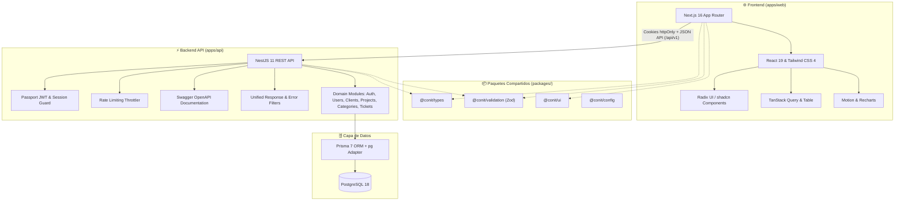
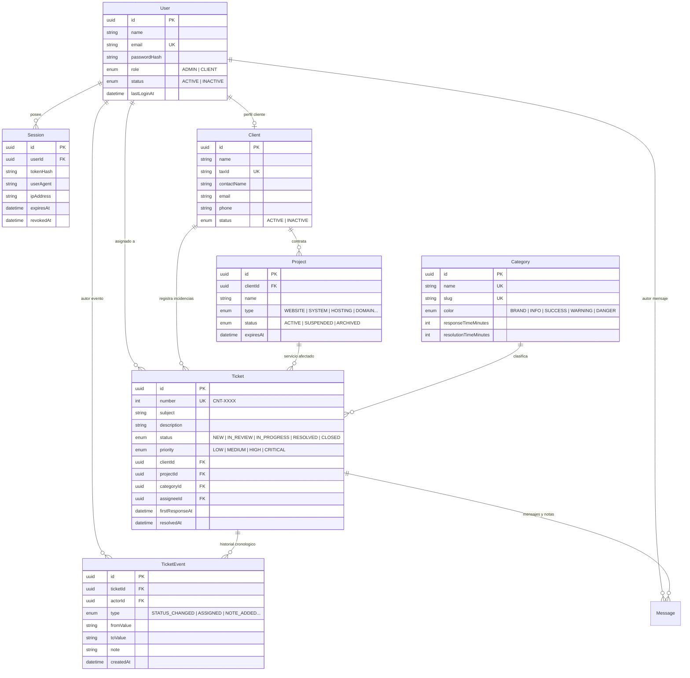

<div align="center">
  
  
  <br />
  <br />

  # CONIT Support Desk
  ### 🚀 Sistema Corporativo Omnicanal de Gestión de Soporte Técnico, Tickets y SLA

  <p align="center">
    <strong>Plataforma integral para centralizar, gestionar y optimizar el ciclo de vida de incidencias, servicios contratados y soporte técnico empresarial en tiempo real.</strong>
  </p>

  <p align="center">
    <a href="https://turbo.build/repo"></a>
    <a href="https://nextjs.org/"></a>
    <a href="https://react.dev/"></a>
    <a href="https://nestjs.com/"></a>
    <a href="https://www.prisma.io/"></a>
    <a href="https://www.postgresql.org/"></a>
    <a href="https://tailwindcss.com/"></a>
    <a href="https://www.docker.com/"></a>
    <a href="https://www.typescriptlang.org/"></a>
  </p>

  <p align="center">
    <a href="#-descripción-del-proyecto">Descripción</a> •
    <a href="#-características-principales">Características</a> •
    <a href="#-arquitectura-del-sistema">Arquitectura</a> •
    <a href="#-stack-tecnológico">Tecnologías</a> •
    <a href="#-estructura-del-monorepo">Estructura</a> •
    <a href="#-inicio-rápido">Inicio Rápido</a> •
    <a href="#-despliegue-con-docker">Docker</a> •
    <a href="#-seguridad-y-autenticación">Seguridad</a> •
    <a href="#-documentación-de-la-api">API & Swagger</a> •
    <a href="#-modelo-de-datos">Base de Datos</a>
  </p>
</div>

---

## 📋 Descripción del Proyecto

**CONIT Support** es la solución tecnológica centralizada de **CONIT** para coordinar y dar seguimiento al soporte técnico especializado de los servicios corporativos brindados a clientes:

- 🌐 **Sitios Web y Portales Corporativos**
- 💻 **Sistemas Web y Aplicaciones Empresariales**
- 🎓 **Aulas Virtuales y Plataformas E-Learning**
- ☁️ **Servidores Cloud, Hosting y Dominios**
- 📧 **Servidores y Cuentas de Correo Corporativo**
- 🗄️ **Bases de Datos e Infraestructura Crítica**

El sistema permite al equipo técnico y administradores gestionar clientes, registrar proyectos/servicios contratados, dar trazabilidad exhaustiva a incidencias mediante tickets, supervisar tiempos de respuesta y resolución (SLA) y emitir comunicaciones internas y públicas con auditoría total.

> ### 📌 Estado de Desarrollo: **Fase 2 — Núcleo de Tickets y Clientes**
> - ✅ **Fase 1 (Completada):** Arquitectura Monorepo (`pnpm` + `Turborepo`), Autenticación robusta basada en sesiones en BD y cookies `httpOnly`, panel administrativo base, Design System corporativo e infraestructura Docker.
> - ✅ **Fase 2 (Actual):** Módulos completos de Clientes, Proyectos/Servicios, Categorías con SLAs, Gestión de Tickets con ciclo de vida completo (`CNT-XXXX`), asignación, prioridades, bitácora de eventos y dashboard conectado a datos reales.
> - ⏳ **Fase 3 (En Roadmap):** Hilos de conversación bidireccionales, Base de Conocimiento con artículos de autoayuda, notificaciones omnicanal (email/push), reportes analíticos exportables y conector de Inteligencia Artificial (`AiProvider`).

---

## ✨ Características Principales

<table>
  <tr>
    <td width="50%">
      <h3>🎫 Gestión Integral de Tickets</h3>
      <ul>
        <li><strong>Numeración Atómica:</strong> Generación garantizada de códigos secuenciales correlativos (ej. <code>CNT-0042</code>).</li>
        <li><strong>Ciclo de Vida Completo:</strong> Estados <code>NUEVO</code>, <code>EN REVISIÓN</code>, <code>EN PROGRESO</code>, <code>RESUELTO</code> y <code>CERRADO</code>.</li>
        <li><strong>Matriz de Prioridad:</strong> Niveles <code>Baja</code>, <code>Media</code>, <code>Alta</code> y <code>Crítica</code>.</li>
        <li><strong>Auditoría Inmutable:</strong> Trazabilidad cronológica de cada cambio de estado, asignación y notas técnicas internas (<code>TicketEvent</code>).</li>
        <li><strong>Control de SLA:</strong> Medición de tiempo de primera respuesta y tiempo total de resolución.</li>
      </ul>
    </td>
    <td width="50%">
      <h3>👥 Clientes y Servicios 360°</h3>
      <ul>
        <li><strong>Directorio Empresarial:</strong> Registro de clientes con identificación fiscal (RUC), contactos clave, teléfonos y correos.</li>
        <li><strong>Catálogo de Servicios:</strong> Asociación de servicios activos (Hosting, Dominios, Sistemas, Aulas Virtuales).</li>
        <li><strong>Alertas de Vencimiento:</strong> Detección automática de servicios próximos a expirar (<code>expiringSoon</code>).</li>
        <li><strong>Integridad Referencial:</strong> Protección contra borrado accidental de clientes con historial de incidencias activo.</li>
      </ul>
    </td>
  </tr>
  <tr>
    <td width="50%">
      <h3>📊 Dashboard, Reportes y Analítica</h3>
      <ul>
        <li><strong>KPIs en Tiempo Real:</strong> Total de tickets activos, clientes atendidos, servicios en curso y tiempos promedio de respuesta.</li>
        <li><strong>Gráficos Interactivos:</strong> Distribución visual por estado, prioridad y categoría mediante <code>Recharts</code>.</li>
        <li><strong>Reportes Operativos:</strong> Volumen por periodo, tiempos medios y <strong>cumplimiento del objetivo de cada categoría</strong>, con desglose por cliente, categoría y responsable.</li>
        <li><strong>Exportación CSV:</strong> Generada en el servidor sobre el periodo completo, no sobre la página visible.</li>
        <li><strong>Honestidad en el dato:</strong> Cuando una métrica no se puede medir se devuelve <code>null</code> y la interfaz muestra una raya, nunca un cero inventado.</li>
      </ul>
    </td>
    <td width="50%">
      <h3>🔐 Seguridad y Sesiones Blindadas</h3>
      <ul>
        <li><strong>Cookies HttpOnly:</strong> Tokens de acceso y refresco totalmente invisibles para JavaScript en el navegador (Anti-XSS).</li>
        <li><strong>Sesiones Persistidas:</strong> Cierre de sesión real en base de datos con revocación granular por dispositivo.</li>
        <li><strong>Rotación de Refresh Tokens:</strong> Detección instantánea de reutilización anómala y revocación preventiva de emergencia.</li>
        <li><strong>Argon2id:</strong> Criptografía de contraseñas de vanguardia según recomendaciones OWASP.</li>
        <li><strong>Rate Limiting:</strong> Protección contra ataques de fuerza bruta en endpoints críticos (5 peticiones/minuto en login).</li>
      </ul>
    </td>
  </tr>
  <tr>
    <td width="50%">
      <h3>💬 Conversaciones y Base de Conocimiento</h3>
      <ul>
        <li><strong>Hilo por Ticket:</strong> Mensajes públicos para el cliente y notas internas para el equipo, distinguidos visualmente.</li>
        <li><strong>Primera Respuesta Real:</strong> Solo un mensaje público la marca; una nota interna no, porque el cliente no la ve.</li>
        <li><strong>Autoría Protegida:</strong> Cada persona edita y borra únicamente sus propios mensajes.</li>
        <li><strong>Artículos en Markdown:</strong> Renderizado a nodos de React, sin <code>dangerouslySetInnerHTML</code>: la inyección de HTML es imposible por construcción.</li>
        <li><strong>Búsqueda y Etiquetas:</strong> Filtrado por categoría, etiqueta y texto libre sobre título, resumen y contenido.</li>
      </ul>
    </td>
    <td width="50%">
      <h3>🔔 Avisos e Inteligencia Artificial</h3>
      <ul>
        <li><strong>Avisos por Evento Real:</strong> Asignación, cambio de estado y nuevos mensajes, emitidos dentro de la transacción que los origina.</li>
        <li><strong>Sin Ruido Propio:</strong> Nadie recibe un aviso de una acción que acaba de hacer él mismo.</li>
        <li><strong>Preferencias por Tipo:</strong> Cada usuario elige qué avisos recibe; un fallo al emitir nunca tumba la operación.</li>
        <li><strong>Asistente Opcional:</strong> Redacta respuestas, sugiere clasificación y resume casos vía OpenRouter. Sin clave configurada se declara no disponible y el resto del sistema funciona igual.</li>
        <li><strong>Sugerencias, no Decisiones:</strong> La categoría sale del catálogo real y nada se aplica sin que una persona lo confirme.</li>
      </ul>
    </td>
  </tr>
</table>

---

## 🏗️ Arquitectura del Sistema



### Decisiones de Diseño & Arquitectura

| Decisión de Ingeniería | Implementación & Beneficios |
| :--- | :--- |
| **Monorepo Turborepo** | Permite compartir contratos TypeScript (`@conit/types`) y esquemas de validación Zod (`@conit/validation`) entre backend y frontend sin duplicar código ni generar divergencias de contrato. |
| **Seguridad Zero-Trust en Rutas** | `JwtAuthGuard` está configurado como guardián global en NestJS. Todas las rutas nacen protegidas por defecto, requiriendo el decorador explícito `@Public()` para abrirse. |
| **Sesiones con Estado (Stateful JWT)** | La sesión se valida contra la tabla `sessions` en PostgreSQL, permitiendo revocar dispositivos específicos, ver sesiones activas y detectar el robo de tokens mediante detección de reutilización. |
| **Respuesta Única Homogénea** | Interceptor global que transforma todas las respuestas exitosas a `{ success: true, message, data }` y filtro global para errores `{ success: false, message, error }`. |
| **Validación Extremo a Extremo** | Los mismos esquemas Zod definidos en `@conit/validation` validan los formularios en React Hook Form y los DTOs en el pipeline de NestJS. |

---

## 🛠️ Stack Tecnológico

### 🚀 Monorepo & Herramientas de Desarrollo
- **Gestor de Paquetes:** `pnpm 10` con workspaces
- **Build System:** `Turborepo 2.10`
- **Lenguaje:** `TypeScript 5.9` (Modo Estricto total)
- **Calidad de Código:** `ESLint 9` + `Prettier 3` con ordenamiento automático de imports

### 💻 Frontend (`apps/web`)
- **Framework:** `Next.js 16.3` (App Router con Server Components y Client Components)
- **Biblioteca UI:** `React 19`
- **Estilos:** `Tailwind CSS 4.0` con variables de diseño CSS modernas
- **Componentes:** Primitivas de `Radix UI` inspiradas en `shadcn/ui`
- **Gestión de Estado & Caché:** `TanStack Query v5` (React Query)
- **Tablas de Datos:** `TanStack Table v9` (ordenamiento, filtrado y paginación)
- **Formularios & Validación:** `React Hook Form` + `Zod 4`
- **Gráficos & Animaciones:** `Recharts 3` + `Motion` (Framer Motion)
- **Notificaciones & Temas:** `Sonner` (Toasts interactivos) + `next-themes` (Dark/Light mode)
- **Iconografía:** `Lucide React`

### ⚙️ Backend API (`apps/api`)
- **Framework:** `NestJS 11.2` (Arquitectura modular con Inyección de Dependencias)
- **ORM & Conectores:** `Prisma 7.10` con adaptador nativo `@prisma/adapter-pg`
- **Base de Datos:** `PostgreSQL 18`
- **Autenticación & Hashing:** `Passport JWT` + `@node-rs/argon2` (OWASP standard)
- **Seguridad Web:** `Helmet` (Headers HTTP reforzados) + `@nestjs/throttler` (Rate Limiter)
- **Health Checks:** `@nestjs/terminus` (Monitorización de salud y conexión Postgres)
- **Documentación API:** `Swagger / OpenAPI 3.0`

### 📦 Paquetes del Espacio de Trabajo (`packages/`)
- `@conit/types`: Contratos TypeScript unificados para respuestas de API, entidades y enumeraciones.
- `@conit/validation`: Reglas de validación y esquemas Zod compartidos entre Web y API.
- `@conit/ui`: Componentes base, botones, modales, alertas, skeletons y estados de carga.
- `@conit/config`: Configuraciones reutilizables de TypeScript, ESLint y Prettier.

---

## 📁 Estructura del Monorepo

```text
conit-support/
├── 📁 apps/
│   ├── 📁 api/                             # Backend REST API en NestJS 11
│   │   ├── 📁 prisma/
│   │   │   ├── schema.prisma               # Esquema de base de datos relacional
│   │   │   ├── seed.ts                     # Semilla de usuarios y datos de demostración
│   │   │   └── migrations/                 # Historial de migraciones SQL
│   │   ├── prisma.config.ts                # Configuración de Prisma 7 CLI
│   │   └── 📁 src/
│   │       ├── main.ts                     # Bootstrap: Helmet, CORS, ValidationPipe
│   │       ├── app.module.ts               # Módulo raíz, guards e interceptores
│   │       ├── swagger.ts                  # Configuración de Swagger / OpenAPI
│   │       ├── 📁 auth/                    # Login, Refresh de tokens, Logout y Sesiones
│   │       ├── 📁 users/                   # Perfil y gestión de usuarios
│   │       ├── 📁 clients/                 # CRUD y opciones de clientes
│   │       ├── 📁 projects/                # Servicios contratados y vencimientos
│   │       ├── 📁 categories/              # Categorías de tickets y SLAs
│   │       ├── 📁 tickets/                 # Gestión de tickets, eventos y notas
│   │       ├── 📁 dashboard/               # Métricas, KPIs y resúmenes analíticos
│   │       ├── 📁 health/                  # Endpoint /health con Terminus
│   │       ├── 📁 ai/                      # Contrato abstracto para integración IA
│   │       ├── 📁 common/                  # Decoradores (@Public, @CurrentUser), filtros y guards
│   │       ├── 📁 config/                  # Validación estricta de variables de entorno
│   │       └── 📁 database/                # PrismaService y conexión de datos
│   │
│   └── 📁 web/                             # Frontend Next.js 16 (App Router)
│       ├── 📁 public/brand/                # Logotipos e isotipos corporativos
│       └── 📁 src/
│           ├── 📁 app/
│           │   ├── (auth)/login/           # Pantalla de inicio de sesión
│           │   └── admin/                  # Panel administrativo protegido
│           │       ├── dashboard/          # Métricas y gráficos
│           │       ├── tickets/            # Listado y detalle de incidencias
│           │       ├── clients/            # Gestión de clientes
│           │       ├── projects/           # Proyectos y servicios
│           │       ├── categories/         # Catálogo de categorías
│           │       └── ...                 # Módulos adicionales
│           ├── 📁 components/              # Componentes React (layout, tablas, auth, brand)
│           ├── 📁 hooks/                   # Custom Hooks (useSession, useTickets, useClients)
│           ├── 📁 lib/                     # Cliente HTTP (fetch wrapper), toasts, utilidades
│           ├── 📁 services/                # Capa de consumo de API por módulo
│           └── proxy.ts                    # Protección y ruteo de sesión en Next.js
│
├── 📁 packages/
│   ├── 📁 ui/                              # Design System y componentes reutilizables
│   ├── 📁 types/                           # Contratos e interfaces de TypeScript
│   ├── 📁 validation/                      # Esquemas Zod compartidos
│   └── 📁 config/                          # Presets de TS, ESLint y Prettier
│
├── 📁 assets/                              # Recursos gráficos y branding para documentación
├── 📁 docker/                              # Dockerfiles optimizados multi-stage
│   ├── api.Dockerfile
│   └── web.Dockerfile
├── 📁 scripts/
│   ├── setup-env.mjs                       # Generador seguro de variables de entorno
│   └── setup-db-local.mjs                  # Script para inicialización de PostgreSQL local
├── docker-compose.yml                      # Orquestación de contenedores (Postgres, API, Web)
├── pnpm-workspace.yaml                     # Definición del espacio de trabajo pnpm
├── turbo.json                              # Configuración de pipeline y caché de Turborepo
└── package.json                            # Scripts raíz del proyecto
```

---

## ⚡ Inicio Rápido

### 1. Requisitos Previos

| Requisito | Versión Mínima | Comando de Verificación |
| :--- | :--- | :--- |
| **Node.js** | `>= 22.0.0` | `node -v` |
| **pnpm** | `>= 10.0.0` | `pnpm -v` |
| **Docker & Compose** *(opcional)* | `>= 24.0.0` | `docker -v` |
| **PostgreSQL** | `17` o `18` | `psql --version` (o mediante Docker) |

---

### 2. Pasos de Instalación

#### Paso 1: Clonar el Repositorio
```bash
git clone https://github.com/Luiscarranza13/conit-support.git
cd conit-support
```

#### Paso 2: Instalar Dependencias
```bash
pnpm install
```

#### Paso 3: Inicializar Variables de Entorno
Ejecuta el asistente automatizado que crea `.env`, `apps/api/.env` y `apps/web/.env.local` con **secretos criptográficos generados aleatoriamente**:
```bash
pnpm setup:env
```

> 💡 **Nota:** Edita `apps/api/.env` y `.env` para definir tus contraseñas locales (`POSTGRES_PASSWORD`, `ADMIN_PASSWORD`).

---

### 3. Configuración de Base de Datos

Puedes elegir cualquiera de las dos alternativas:

#### 🔹 Opción A: Usando Docker (Recomendado)
Levanta la instancia de PostgreSQL 18 en segundo plano:
```bash
docker compose up -d postgres
```

#### 🔹 Opción B: PostgreSQL Local (Sin Docker)
Si ya tienes PostgreSQL instalado en tu máquina:
```bash
pnpm db:setup
```

---

### 4. Ejecutar Migraciones y Datos Semilla

Genera el cliente de Prisma, aplica las migraciones y siembra los usuarios iniciales:
```bash
pnpm db:migrate
pnpm db:seed
```

> ℹ️ **Datos de demostración:** Para poblar la base con clientes, servicios, tickets y artículos de ejemplo, añade `SEED_DEMO_DATA=true` en `apps/api/.env` antes de ejecutar `pnpm db:seed`. Está desactivado por defecto para que nunca lleguen a un despliegue real.
>
> El seed es idempotente y **omite lo que ya existe**. Si cambias los datos de demostración y quieres regenerarlos, retira antes los tickets sembrados con `node scripts/cleanup-test-data.cjs` o `node scripts/reset-demo-tickets.cjs` desde `apps/api/`.

---

### 5. Iniciar en Modo Desarrollo

Levanta todas las aplicaciones simultáneamente con Turborepo:
```bash
pnpm dev
```

---

### 🌐 Accesos Locales

| Servicio | URL Local | Descripción |
| :--- | :--- | :--- |
| **Panel Web Administrativo** | [http://localhost:3000](http://localhost:3000) | Aplicación Next.js 16 |
| **Backend REST API** | [http://localhost:4000/api/v1](http://localhost:4000/api/v1) | Endpoint base de la API |
| **Swagger / Documentación Interactiva** | [http://localhost:4000/api/docs](http://localhost:4000/api/docs) | Explorador OpenAPI |
| **Health Check & Estado de Postgres** | [http://localhost:4000/health](http://localhost:4000/health) | Monitor de salud del sistema |

---

## 🐳 Despliegue con Docker

El proyecto incluye configuración lista para producción con Docker Compose y Dockerfiles multi-stage con optimización de capas.

### Levantar todo el stack (PostgreSQL + API + Web):
```bash
docker compose up -d --build
```

### Ejecutar migraciones y semilla en el contenedor:
```bash
docker compose exec api prisma db seed
```

### Ver logs en tiempo real:
```bash
docker compose logs -f api
docker compose logs -f web
```

### Detener los servicios:
```bash
docker compose down
```
*(Para eliminar también el volumen de base de datos usa `docker compose down -v`)*.

---

## 📚 Documentación de la API

La API cuenta con documentación interactiva **Swagger / OpenAPI** disponible en `http://localhost:4000/api/docs`.

### Resumen de Endpoints Principales

| Método | Ruta | Acceso | Descripción |
| :--- | :--- | :--- | :--- |
| `GET` | `/health` | Público | Comprobación de salud de la API y PostgreSQL. |
| `POST` | `/api/v1/auth/login` | Público *(5 req/min)* | Inicia sesión y emite cookies `httpOnly`. |
| `POST` | `/api/v1/auth/refresh` | Sesión activa | Rota el refresh token y renueva el access token. |
| `POST` | `/api/v1/auth/logout` | Sesión activa | Revoca la sesión en base de datos y destruye cookies. |
| `GET` | `/api/v1/users/me` | Autenticado | Obtiene la información del usuario autenticado. |
| `GET` | `/api/v1/users/options` | Admin | Lista especialistas disponibles para asignación. |
| `GET` | `/api/v1/dashboard/summary` | Admin | Retorna KPIs, métricas de tickets y actividad reciente. |
| `GET` / `POST` | `/api/v1/clients` | Admin | Listado paginado con búsqueda y creación de clientes. |
| `GET` / `PATCH` / `DELETE` | `/api/v1/clients/:id` | Admin | Detalle, actualización y baja de clientes. |
| `GET` / `POST` | `/api/v1/projects` | Admin | Gestión de servicios y filtro `expiringSoon`. |
| `GET` | `/api/v1/projects/options/:clientId` | Admin | Lista servicios activos asociados a un cliente. |
| `GET` / `POST` | `/api/v1/categories` | Admin | Catálogo de categorías, colores y tiempos SLA. |
| `GET` / `POST` | `/api/v1/tickets` | Admin | Listado avanzado con filtros y registro de tickets. |
| `GET` / `PATCH` / `DELETE` | `/api/v1/tickets/:idOrCode` | Admin | Consulta por UUID o código (ej. `CNT-0001`), edición y cierre. |
| `GET` / `POST` | `/api/v1/tickets/:idOrCode/messages` | Admin | Conversación del ticket: mensajes públicos y notas internas. |
| `PATCH` / `DELETE` | `/api/v1/tickets/:idOrCode/messages/:id` | Autor | Edición y borrado, restringidos al autor del mensaje. |
| `GET` | `/api/v1/users/team` | Admin | Carga de trabajo del equipo de soporte y tickets sin asignar. |
| `PATCH` | `/api/v1/users/me` | Autenticado | Edición del propio perfil. |
| `POST` | `/api/v1/auth/change-password` | Sesión activa | Cambia la contraseña y revoca el resto de sesiones. |
| `GET` | `/api/v1/audit` | Admin | Historial de auditoría con filtros por tipo, autor y fechas. |
| `GET` | `/api/v1/audit/summary` | Admin | Resumen del historial sobre el mismo filtro que el listado. |
| `GET` / `POST` | `/api/v1/articles` | Admin | Base de conocimiento: listado con búsqueda y alta de artículos. |
| `GET` / `PATCH` / `DELETE` | `/api/v1/articles/:idOrSlug` | Admin | Consulta por UUID o slug, edición y borrado. |
| `POST` | `/api/v1/articles/:idOrSlug/views` | Admin | Registra una lectura (separado de la consulta). |
| `GET` | `/api/v1/reports` | Admin | Volumen, tiempos medios y cumplimiento de objetivos del periodo. |
| `GET` | `/api/v1/reports/export` | Admin | Exportación CSV de los tickets del periodo. |
| `GET` | `/api/v1/notifications` | Autenticado | Avisos del usuario autenticado, con filtros. |
| `GET` | `/api/v1/notifications/count` | Autenticado | Número de avisos sin leer (indicador de la campana). |
| `GET` / `PATCH` | `/api/v1/notifications/preferences` | Autenticado | Preferencias por tipo de aviso. |
| `GET` | `/api/v1/ai/status` | Admin | Disponibilidad del asistente y modelo activo. |
| `POST` | `/api/v1/ai/tickets/:idOrCode/reply` | Admin | Propone un borrador de respuesta para el cliente. |
| `POST` | `/api/v1/ai/tickets/:idOrCode/classify` | Admin | Sugiere categoría y prioridad a partir del catálogo real. |
| `POST` | `/api/v1/ai/tickets/:idOrCode/summary` | Admin | Resume el caso y lista los próximos pasos. |

### Contrato Estándar de Respuesta

**Respuesta Exitosa (`2xx`):**
```json
{
  "success": true,
  "message": "Operación realizada correctamente",
  "data": { ... }
}
```

**Respuesta con Error (`4xx` / `5xx`):**
```json
{
  "success": false,
  "message": "Credenciales de acceso incorrectas",
  "error": "UNAUTHORIZED"
}
```

---

## 🗄️ Modelo de Datos



---

## ⌨️ Scripts Disponibles

En la raíz del monorepo puedes ejecutar:

| Comando | Acción |
| :--- | :--- |
| `pnpm dev` | Inicia todas las aplicaciones y paquetes en modo desarrollo. |
| `pnpm build` | Compila todas las aplicaciones para producción. |
| `pnpm start` | Inicia las aplicaciones compiladas en modo producción. |
| `pnpm lint` | Analiza el código con ESLint en todo el monorepo. |
| `pnpm typecheck` | Ejecuta la verificación estricta de tipos de TypeScript. |
| `pnpm format` | Formatea el código con Prettier y plugins de Tailwind. |
| `pnpm setup:env` | Asistente interactivo de generación de variables de entorno seguras. |
| `pnpm db:setup` | Asistente de configuración de PostgreSQL local. |
| `pnpm db:migrate` | Ejecuta las migraciones de Prisma en la base de datos. |
| `pnpm db:seed` | Ejecuta la siembra de usuarios iniciales y datos demo. |
| `pnpm db:studio` | Abre la interfaz web de Prisma Studio para explorar los datos. |
| `pnpm clean` | Limpia los directorios `dist`, `.turbo`, `.next` y `node_modules`. |

---

## 🔒 Estándares de Seguridad

- **Protección contra XSS:** No se almacena ningún token sensible en `localStorage` o `sessionStorage`. Las credenciales se gestionan únicamente mediante cookies con flags `HttpOnly`, `SameSite` y `Secure`.
- **Protección contra CSRF:** Esquema `SameSite=Lax/Strict` en combinación con encabezados `Origin` y `Referer` validados.
- **Protección de Contraseñas:** Algoritmo **Argon2id** (`@node-rs/argon2`) parametrizado con memoria y paralelismo adecuados.
- **Auditoría de Sesiones:** Detección de uso concurrente o reutilización de tokens robados, revocando automáticamente todas las sesiones activas del usuario comprometido.
- **Prevención de Inyecciones SQL:** Acceso a datos mediante consultas parametrizadas tipadas con **Prisma ORM**.
- **Cabeceras HTTP Seguras:** Configuración de **Helmet** (Content Security Policy, DNS Prefetch Control, Frameguard, Hide Powered-By, HSTS, No Sniff, XSS Filter).

---

## 📄 Licencia

Este proyecto está bajo la licencia **MIT**. Consulta el archivo [LICENSE](LICENSE) para más detalles.

<br />

<div align="center">
  
  <br />
  <sub>Diseñado y desarrollado para <strong>CONIT</strong> • Soluciones Tecnológicas y Soporte Corporativo</sub>
</div>
